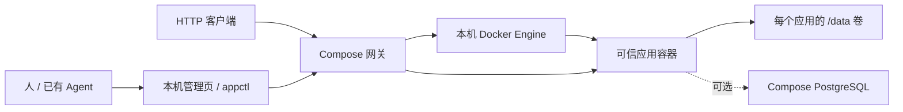

# 总体设计（原型）

## 实际架构

网关保存应用名、镜像及非敏感配置。请求抵达 `/apps/<name>/...` 时按需启动容器、去掉路径前缀并转发 HTTP；活跃请求计数阻止闲置停止，空闲一段时间后后台检查并停止容器。管理端口和应用端口只映射到主机回环地址；应用容器之间及与网关共享 Docker 网络，因此这不是隔离边界。当前 Docker socket 挂载使网关拥有极高主机权限。

应用镜像监听 8000 端口，以 `/data` 保存本地持久文件，并处理 `X-Forwarded-Prefix`。样例使用 SQLite 或通过网络访问 PostgreSQL；`records.py` 提供少量 JSON 文档操作；`relational.py` 提供参数化 SQL 与事务上下文，适用于两种数据库的共同语法。应用仍需自行设计数据模型、SQL、隔离语义和错误处理。API 和权限边界详见 `SCOPE.md`。

管理界面、CLI 和数据卷构成一个可运行的单机纵向切片。当前注册需要预构建镜像；没有镜像构建服务、调度器或自动恢复保障。应用运行状态是 Docker 即时状态而非健康度。有限的 HTTP 缓冲、启动等待以及错误语义在 README 中有明确限制。

## 逻辑扩展方向（未实现）

- **运行面**：将应用注册、路由、生命周期和资源控制分离，逐步适配容器编排，但需先定义状态机和恢复协议。
- **数据面**：围绕明确语义提供适配器、数据迁移、备份和权限边界。不能假设 SQLite 与 PostgreSQL 的所有 SQL、事务和并发行为一致。
- **身份和组织**：在可信服务端验证身份，定义网关与应用之间不可伪造、可审计的上下文协议。现在没有这一协议或实现。
- **Agent 与模板**：将当前文字指南演进为可版本化的模板和工具协议；Agent 可以选择宿主，但当前既无自动初始化类型，也无 iOS 组件。
- **多租户与云运营**：先独立设计租户隔离、恶意负载防护、计量、配额、账单、可靠性和成本模型；当前架构不具备这些保证。

请结合 `docs/adr/` 阅读已验证决定、暂定假设和未来方向。目录 `prototype/` 保存三个验证视角及一次独立 Agent 复验；测量结果不是容量上限或云成本预测。
