<picture>
  <source media="(prefers-color-scheme: dark)" srcset="docs/assets/hero-dark.svg">
  
</picture>

PneumaSpace deploys stateful web apps on one trusted machine. An app names the infrastructure it needs in `pneuma-space.json`. The platform provides it, gives the app a stable address, starts its container on the first request and stops it when idle. Data outlives containers and releases.

## Run the platform

Requirements: Docker with Compose v2, Node.js 24 or newer on the host (for `appctl`).

```sh
docker compose --profile isolate up -d            # gateway, object service, redis, and the runner for isolate apps
docker compose up -d                              # the same without the runner, for container apps only
docker compose --profile postgres --profile rtc up -d   # also PostgreSQL and TURN
```

Console: http://127.0.0.1:8081/ (projects and platform overview). App addresses: `http://127.0.0.1:8080/apps/<name>/`. Object service: http://127.0.0.1:9000. Every port binds loopback. Override ports, network name, credentials and the TURN public host in a `.env` file using the `PNEUMA_SPACE_*` variables in `compose.yaml`; the defaults are for a single trusted machine only.

## Publish an app

```sh
node cli/appctl.ts init myapp                     # templates/app, an isolate app; --container adds a Dockerfile, --static copies templates/static
cd myapp                                          # edit pneuma-space.json and src/server.ts; read AGENTS.md there
node ../cli/appctl.ts publish myapp . --owner user:me
open http://127.0.0.1:8080/apps/myapp/
```

Examples built on the same scaffold, and how to publish them, are in [`examples/`](examples/README.md).

`appctl publish <name> <dir>` reads the manifest. An isolate app is uploaded as a code bundle with its `node_modules` (`npm ci --omit=dev --ignore-scripts` on your machine, no Docker build); a container app is built with Docker; a static directory is uploaded when the manifest declares `static`. Then it registers the release. Publishing the same inputs again changes nothing; a new image or manifest makes a new release and keeps every volume, database, key prefix and bucket.

Other commands: `list`, `show <name>`, `logs <name>` (the app's recent output), `unquarantine <name>` (lets an app the platform stopped for repeated crashes or hangs wake again), `remove <name>` (address returns 404, data kept), `purge <name>` (deletes data, only after remove), `policy [<name>] key=value` (idle, ready, drain, connection-idle and trigger timeouts, `db_backend`, global `timezone`), `owner <name> <subject>`, `token create <name>` (a service token for invoking triggers from outside). `PNEUMA_SPACE_ADMIN` points the CLI at another admin port.

## How a capability is mounted

<picture>
  <source media="(prefers-color-scheme: dark)" srcset="docs/assets/mount-dark.svg">
  
</picture>

A capability is a key in the manifest. Publishing hands each resource kind (`files`, `db`, `kv`, `object`, `rtc`) to its Provider. The Provider's `ensure` creates the backing resource under a name derived from the app's opaque id, and the platform records a binding. Nothing reaches the container yet. When a request wakes the app, `inject` turns every active binding into mounts and `PNEUMA_SPACE_*` variables on the new container. The SDK in [`templates/app/sdk`](templates/app/sdk) reads those variables, so app code calls `db()` and never learns whether SQLite or PostgreSQL answers.

The other kinds (`static`, `ws`, `identity`, `cron`) have no resource. They change how the gateway and the scheduler treat the app's address. A new capability is one row in `CAPABILITIES` plus one Provider whose four operations are safe to run twice. The kinds and their Providers are in [`DESIGN.md`](DESIGN.md) section 1.3; what an app sees is in [`docs/app-contract.md`](docs/app-contract.md).

## One gateway, every app on its own resources

<picture>
  <source media="(prefers-color-scheme: dark)" srcset="docs/assets/gateway-dark.svg">
  
</picture>

Every app lives under one address space, `/apps/<name>/`, behind one gateway process. Each request takes the same path in. The gateway resolves the name and drops any inbound `X-Pneuma-Space-*` header. A file that matches the release's static bundle is served from the object store and wakes nothing. For an app that declares `identity`, the gateway runs the login and sets the subject headers itself. Only then does it acquire the instance, starting the container if it is asleep.

A container stays up while it holds a lease: a request in flight, an open WebSocket or event stream, or a trigger delivery. With no lease and the idle timeout passed, it stops. Cron schedules and on-demand trigger calls wake the app the same way a request does. Object uploads and downloads go from the browser to the object store with presigned URLs, so neither the app nor the gateway carries those bytes and the app can stay asleep. The gateway also counts requests, wakes and deliveries for the console's overview.

Behind the gateway the services are shared: one Docker engine, one Redis, one object store, optionally one PostgreSQL. Each app still owns its names in each of them: a volume, a SQLite volume or a PostgreSQL database and role, a Redis ACL user confined to its key prefix, and a bucket with its own key pair. This is resource namespacing on one trusted host, so apps never trample each other's data. It is not tenant isolation and not a security boundary. App containers share one network and can reach each other, and the operator trusts every image. [`REQUIREMENTS.md`](REQUIREMENTS.md) states the trust boundary.

## Compared with Vercel and Supabase

| | PneumaSpace | Vercel | Supabase |
| --- | --- | --- | --- |
| You deploy | A Node code bundle run in a worker thread, any container image that listens on port 8000, or a static directory | Frontend frameworks and serverless functions from Git | A Postgres project with auth, storage, realtime and edge functions; your own server runs elsewhere |
| It runs on | One machine you own, loopback ports by default | Vercel's global network | Supabase's cloud, or your servers through its self-hosting stack |
| State | Each app declares `/data`, SQL, Redis and an S3 bucket; all survive sleep and new releases | No persistent disk; storage comes from attached services | Postgres at the center, storage buckets beside it |
| Long-lived connections | WebSocket and SSE pass through and keep the app awake | Functions are request-scoped with a time limit | Realtime channels built in; your own long-running server is hosted elsewhere |
| When idle | Containers stop and the next request waits for a cold start of seconds | Scales to zero, managed for you | The database is a running server, not scaled per request |
| Edge, CDN, global reach | None. One host, one location, that machine's bandwidth | Built in | Regional projects with a CDN for storage |
| Sign-in | A local login that asks only for a name, plus service tokens; it identifies, it does not authenticate | Bring your own | Full auth with passwords, OAuth, magic links and row-level security |
| Between apps | No isolation; trusted operator and trusted images only | Isolated by the vendor | Isolated by the vendor |
| Operations | You run Docker, TLS, backups and upgrades | Fully managed | Managed, or run it yourself |
| Cost and vendor | Your hardware; MIT licensed, no account, no vendor service | Proprietary, usage pricing | Open source, hosted with usage pricing |

PneumaSpace fits many small stateful apps that are idle most of the time, on hardware you control, where a cold start of a few seconds is acceptable. Use Vercel for public frontends that must be fast worldwide. Use Supabase when you want a managed Postgres with real user accounts. Organisation features (company sign-in, several nodes, quotas, a CDN) are later milestones and are not in M1.

## Where the facts live

- [`REQUIREMENTS.md`](REQUIREMENTS.md): goals, capabilities, app types and the trust boundary.
- [`DESIGN.md`](DESIGN.md): the model and the architecture.
- [`docs/app-contract.md`](docs/app-contract.md): what an app sees.
- [`docs/acceptance.md`](docs/acceptance.md): acceptance checks and thresholds.
- [`docs/adr/`](docs/adr/): decisions and the options they rejected.
- [`AGENTS.md`](AGENTS.md): conventions for coding agents working on this repository.

The design documents are in Chinese; everything an app developer reads is in English. The illustrations are drawn by [`docs/assets/render.ts`](docs/assets/render.ts) (`node docs/assets/render.ts`).

## Tests

```sh
npm test                                          # unit tests; the runtime and provider suites need Docker
npm run test:acceptance                           # docs/acceptance.md against a real stack on its own ports (project pneuma-space-acc)
```

Run the two one after the other: the provider suite inside `npm test` and the acceptance stack both bind the TURN port 3478.

## License

MIT, see `LICENSE`.
