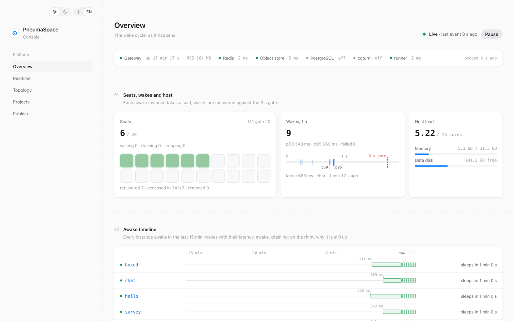
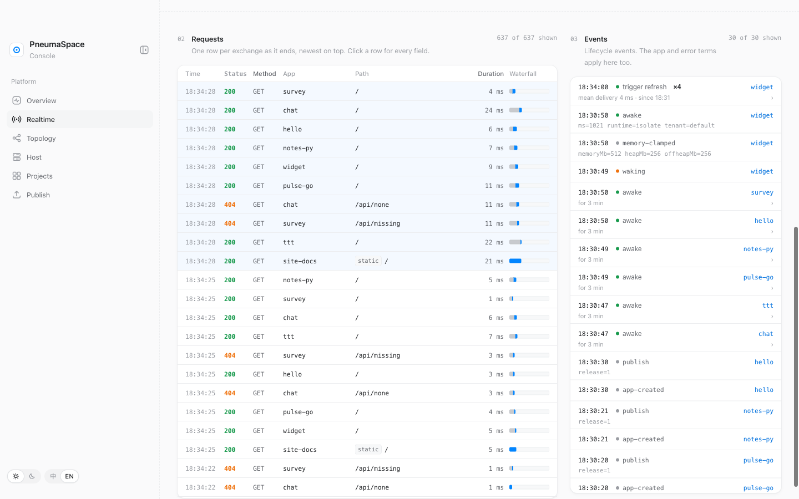
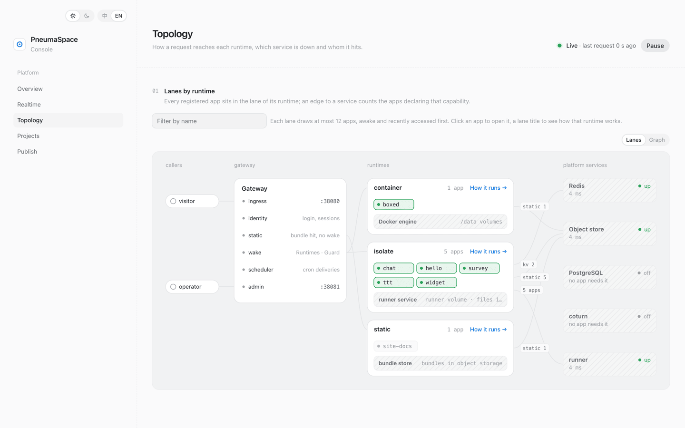
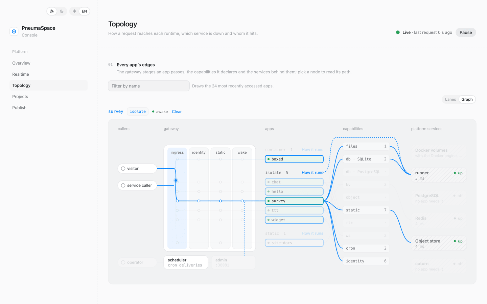
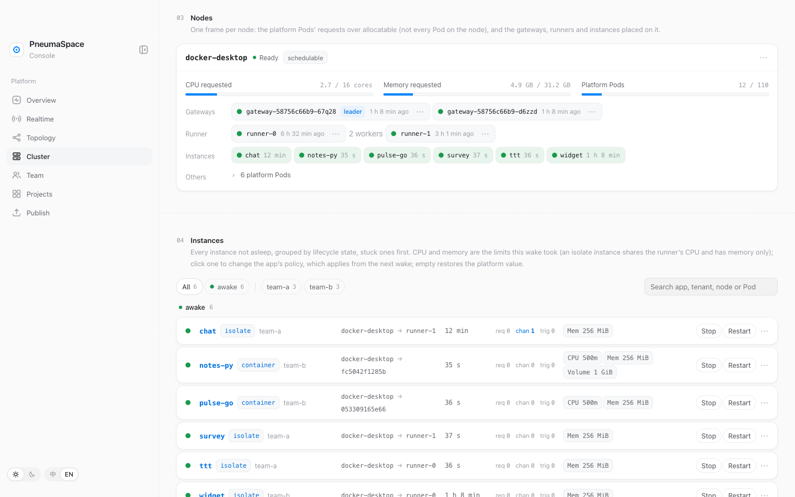

<picture>
  <source media="(prefers-color-scheme: dark)" srcset="docs/assets/hero-dark.svg">
  
</picture>

PneumaSpace runs many small stateful web apps on one machine you own, or on your organization's Kubernetes cluster. An app is a directory whose manifest, `pneuma-space.json`, names the infrastructure it needs; publishing provisions it and gives the app a stable address. The first request wakes the app, idleness puts it to sleep, and its data outlives every sleep and every release. It is built for developers and for the tools that write code for them: publishing is an upload, not a build, and a hung app is stopped without taking its neighbours down. On one machine every app is trusted; on a cluster the organization's members may err but are not hostile. [`REQUIREMENTS.md`](REQUIREMENTS.md) and [`REQUIREMENTS-M2.md`](REQUIREMENTS-M2.md) draw those boundaries and [`DESIGN.md`](DESIGN.md) holds the model.

## Run and publish

The [full hosted profile](deploy/hosted/README.md) adds accounts to the platform below, as required by [the SaaS baseline](REQUIREMENTS-M3.md). Its [verification record](docs/hosted-verification.md) lists completed checks and remaining release gates. The separate [Fetch experiment](cloud/README.md) implements contract 2; it is not the full SaaS product. Its [verification record](docs/saas-verification.md) applies only to that experiment.

Requirements: Docker with Compose v2, and Node.js 24 or newer on the host for `appctl`.

```sh
docker compose --profile isolate up -d            # gateway, object store, Redis, and the runner for isolate apps
docker compose up -d                              # the same without the runner, for container apps only
docker compose --profile postgres --profile rtc up -d   # also PostgreSQL and TURN
```

The console is at http://127.0.0.1:8081/, apps at `http://127.0.0.1:8080/apps/<name>/`, the object store at http://127.0.0.1:9000. Every port binds loopback. Ports, network name, credentials and the TURN public host are `PNEUMA_SPACE_*` variables in `compose.yaml`, overridden in `.env`; the defaults suit one trusted machine only. The same file passes through, empty by default, the variables that put the platform behind an organization's authenticating proxy (`PNEUMA_SPACE_IDENTITY=upstream`) and give each app its own subdomain (`PNEUMA_SPACE_APPS_ORIGIN`); [`docs/app-contract.md`](docs/app-contract.md) says what they change and [ADR 0021](docs/adr/0021-trusted-upstream-identity.md) lists the identity keys.

```sh
node cli/appctl.ts init myapp                     # templates/app, an isolate app; --container adds a Dockerfile, --static copies templates/static
cd myapp                                          # edit pneuma-space.json and src/server.ts; AGENTS.md there is the guide
node ../cli/appctl.ts publish myapp . --owner user:me
open http://127.0.0.1:8080/apps/myapp/
```

`publish` reads the manifest. An isolate app is uploaded as a bundle with its `node_modules` (`npm ci --omit=dev --ignore-scripts` runs on your machine); a container app is built with Docker; a declared `static` directory is uploaded beside it. Publishing the same inputs again changes nothing. A new image or manifest makes a new release and keeps every volume, database, key prefix and bucket.

The other commands are `list`, `show`, `logs`, `unquarantine`, `remove` (the address answers 404, the data stays), `purge` (deletes the data, only after `remove`; `--yes` skips the prompt), `policy`, `owner` and `token create`; `node cli/appctl.ts` prints their arguments. `PNEUMA_SPACE_ADMIN` points the CLI at another admin port. Seven example apps across the three runtimes, and how to publish them, are in [`examples/`](examples/README.md).

## How it runs

<picture>
  <source media="(prefers-color-scheme: dark)" srcset="docs/assets/lanes-dark.svg">
  
</picture>

An app runs in the lane of its runtime ([ADR 0017](docs/adr/0017-pluggable-runtimes.md)). A container app is any image listening on port 8000. An isolate app is a directory of JavaScript run in its own worker thread inside the runner service; a worker adds 17 to 18 MiB to the host. A static site has no process at all. Each lane rests on its own base, and the services on the right are shared: one Redis, one object store, optionally one PostgreSQL. Inside them every app owns its names (a volume, a database, a key prefix, a bucket), so apps never trample each other's data. That is namespacing on one trusted host, not isolation between tenants.

<picture>
  <source media="(prefers-color-scheme: dark)" srcset="docs/assets/graph-dark.svg">
  
</picture>

Every request takes the same path. Ingress resolves the name and drops any inbound `X-Pneuma-Space-*` header; identity runs the login for an app that declares it and sets the subject headers itself; static answers from the release's bundle and wakes nothing; wake acquires the instance through its runtime, and the Guard alone counts crashes and hangs and quarantines the app that keeps failing. Behind the app, each declared capability is one edge to one service. The app reads its bindings from `PNEUMA_SPACE_*` variables, so its code calls `db()` and never learns whether SQLite or PostgreSQL answers. Object bytes go from the browser straight to the bucket with presigned URLs; neither the app nor the gateway carries them. A new capability is one row in `CAPABILITIES` and one Provider; a new runtime is one row in `RUNTIMES` and one class. What an app sees is [`docs/app-contract.md`](docs/app-contract.md).

## What the console shows

The console at `:8081` shows the platform live; its topology page is the two pictures above, drawn from real state. The overview, realtime and topology pages read only gateway memory and make 0 Docker calls while they poll.

| Overview | Realtime |
| --- | --- |
| <picture><source media="(prefers-color-scheme: dark)" srcset="docs/assets/console/overview-dark.png"></picture> | <picture><source media="(prefers-color-scheme: dark)" srcset="docs/assets/console/realtime-dark.png"></picture> |
| **Topology, lanes** | **Topology, graph** |
| <picture><source media="(prefers-color-scheme: dark)" srcset="docs/assets/console/lanes-dark.png"></picture> | <picture><source media="(prefers-color-scheme: dark)" srcset="docs/assets/console/graph-dark.png"></picture> |

## On a Kubernetes cluster

The organization edition runs the same platform on a Kubernetes cluster ([ADR 0019](docs/adr/0019-kubernetes-plane.md) to [ADR 0026](docs/adr/0026-cluster-page-and-operations.md)). An app publishes there unchanged and gets its own subdomain. Each instance is a Pod with its own volume, isolate apps run in a pool of runner Pods, and the gateway runs as several replicas that keep instance state in PostgreSQL. People sign in through the organization's authenticating proxy, which hands the gateway a signed JWT; the platform has no login of its own. Apps belong to tenants, one per team, with members, tokens and quotas on the Team page. The Cluster page shows nodes, replicas, platform services and every instance; a platform admin scales the gateway and the runners there, restarts their Pods, moves the instances off a node, and stops, restarts or force-releases an instance. [`deploy/kubernetes/README.md`](deploy/kubernetes/README.md) installs it; its last section runs it on Docker Desktop.

<picture><source media="(prefers-color-scheme: dark)" srcset="docs/assets/console/cluster-dark.png"></picture>

## Compared with Vercel and Supabase

Vercel and Supabase run your app on their infrastructure. PneumaSpace runs every app on a machine or a cluster you own.

You gain:

- State per app that survives sleep and release: a directory, a SQL database, a key prefix, a bucket.
- Scale to zero per app: a sleeping isolate wakes in 62 to 87 ms, a container in about 260 ms.
- WebSocket and SSE that stay open and keep the app awake.
- Publishing without a build: the isolate scaffold is live 6.9 s after `publish`.
- No account and no vendor service; MIT licensed, any S3-compatible store.

You give up:

- Reach: your own machines in one location; no CDN, no edge.
- Isolation between apps: every image is trusted, and no tenant is isolated against a hostile one.
- Authentication on one machine: the built-in login asks only for a name; it identifies, it does not authenticate. A cluster relies on your organization's proxy.
- Managed operations: you run Docker or Kubernetes, TLS, backups and upgrades.

Metering, billing, a CDN and isolation against hostile tenants are in neither edition.

## Where the facts live

- [`REQUIREMENTS.md`](REQUIREMENTS.md): goals, capabilities, app types and the trust boundary.
- [`REQUIREMENTS-M2.md`](REQUIREMENTS-M2.md): users, tenants, the cluster and its operation in the organization edition.
- [`DESIGN.md`](DESIGN.md): the model and the architecture.
- [`docs/app-contract.md`](docs/app-contract.md): what an app sees.
- [`docs/acceptance.md`](docs/acceptance.md): acceptance checks and thresholds.
- [`docs/console.md`](docs/console.md): how every console page is designed.
- [`deploy/kubernetes/README.md`](deploy/kubernetes/README.md): installing on a cluster.
- [`docs/adr/`](docs/adr/): decisions and the options they rejected.
- [`AGENTS.md`](AGENTS.md): conventions for working on this repository.

The design documents are in Chinese; everything an app developer reads is in English. [`docs/assets/render.ts`](docs/assets/render.ts) draws the illustrations (`node docs/assets/render.ts`).

## Tests

```sh
npm run test:unit                                 # in-process, seconds
npm test                                          # also the runner and Docker suites (AGENTS.md says which change needs which)
npm run test:acceptance                           # docs/acceptance.md against a real stack on its own ports (project pneuma-space-acc)
npm run test:k8s                                  # the cluster rows, against the context PNEUMA_SPACE_TEST_KUBECONTEXT names
```

Run the two one after the other: the provider suite inside `npm test` and the acceptance stack both bind the TURN port 3478.

## License

MIT, see `LICENSE`.
