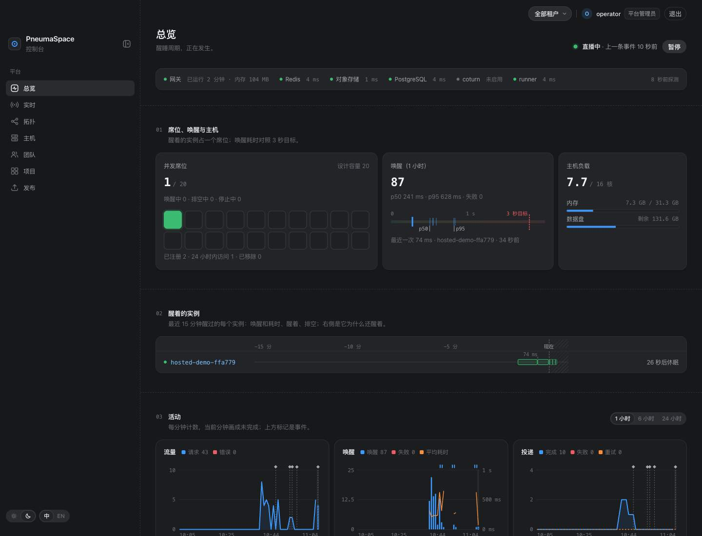
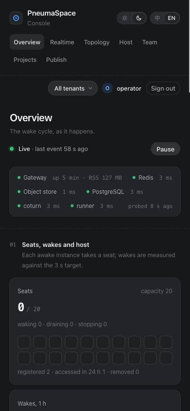
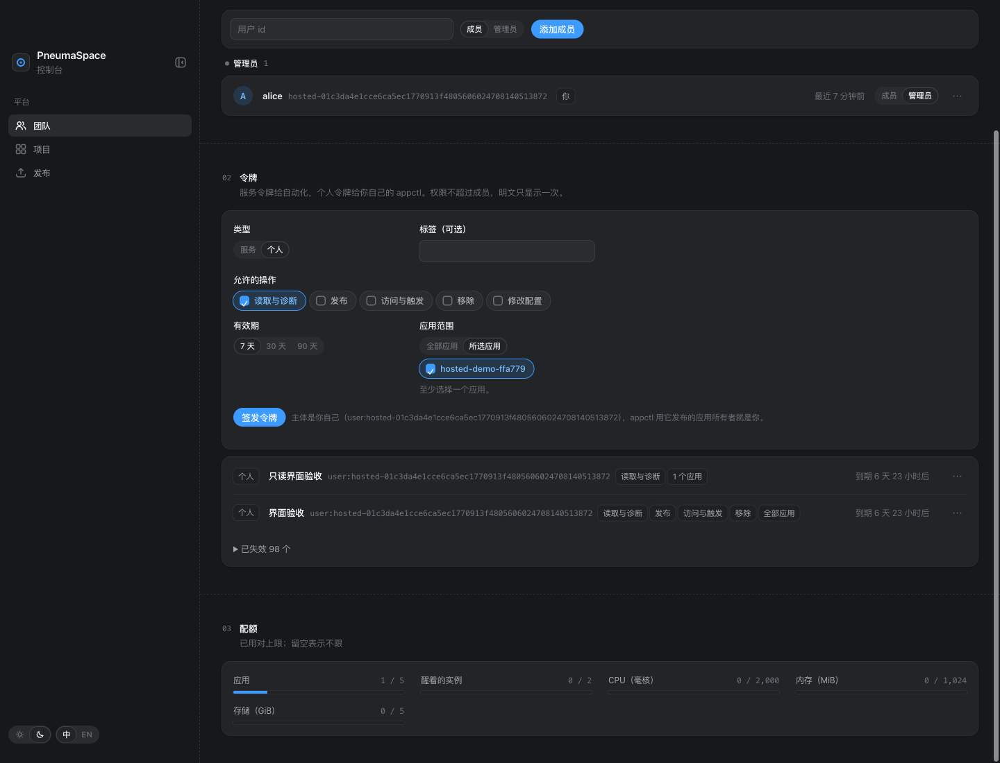
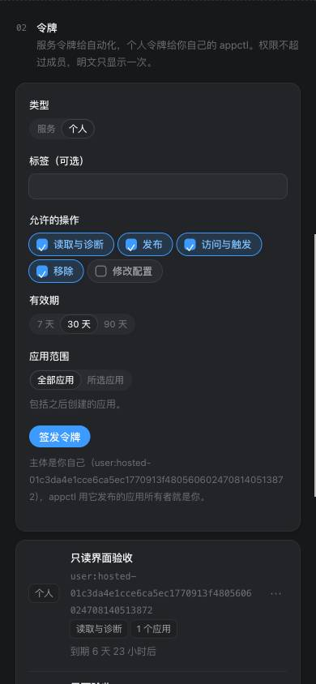

# Hosted platform verification

Verified locally on 2026-11-12 at runtime revision `c091c43`. Host checks used Node 25.1.0; the Compose gateway used Node 24.22.2. The hosted stack used its own project, network, volumes and ports.

The full hosted profile works on Compose. This is a functional result within [ADR 0030](adr/0030-additive-hosted-platform.md), not completion of the [public SaaS release gates](acceptance.md#full-platform-saas) or [G14](../REQUIREMENTS-M3.md#目标).

## Automated runs

| Run | Result |
| --- | --- |
| `npm run test:unit` | 466 passed, 1 Linux-only RSS assertion skipped on macOS, 0 failures |
| `npm run test:runner` | 64 passed |
| `npm run test:docker` | 96 passed against real containers and PostgreSQL |
| `npm run test:acceptance` | All 49 original Compose acceptance checks passed in one serial run |
| `PNEUMA_SPACE_HOSTED_TEST_RTC=true PNEUMA_SPACE_HOSTED_TEST_PAUSE_OBJECTS=true npm run test:hosted` | All 29 hosted checks passed, no skips |
| `python3 -m unittest discover -s prototype/00-appbase-python/tests -v` | 18 passed |
| `npm --prefix cloud test` | 158 passed for the retained Fetch experiment |
| `npm --prefix cloud run typecheck` | Passed |
| `kubectl kustomize deploy/hosted/kubernetes` | Rendered successfully |
| `npm run test:k8s` | 13 skipped because `PNEUMA_SPACE_TEST_KUBECONTEXT` was unset; no cluster pass is claimed |

The hosted run covers the three original runtimes, file and SQL persistence, PostgreSQL, KV and pubsub, direct object transfer, WebSocket, SSE, on-demand and scheduled triggers, and RTC configuration. It also checks account boundaries, credential scope and AppId binding, browser grants, CSRF, logout, revocation, typed purge and credential stripping. The store suites exercise registration races and migration preservation against SQLite and PostgreSQL.

The pending-publication check briefly pauses only the hosted development object service. It observes a newly provisioned KV binding, revokes the deployment credential, resumes the object service and checks a 403 result. The prior release and its file remain readable. The test restores the service in `finally` and deletes only its own fixtures.

## Browser and CLI checks

The original CLI initialized and published an unchanged isolate template using a personal credential issued in the original console. Its private address completed the browser login flow, returned `Hello, alice` and removed the grant from the URL. Revoking the credential caused the next CLI publication to fail with 401.

The operator's Overview, Realtime, Topology, Host, Team, Projects and Publish pages were inspected in English and Chinese at 1440, 1280, 1024, 900, 768 and 390 px. Metrics and request records came from the running gateway. Alice's pages retained app diagnostics and tenant controls while global operator APIs returned 403.

Both languages completed credential issue and revocation, application navigation and typed purge. An empty selected-app scope was refused; selecting one app issued a credential restricted to that AppId and `read`. A wrong purge name kept the button disabled; the correct name allowed deletion, after which the app returned 404. Logout caused a previously opened private app to require sign-in on its next request. No checked page scrolled horizontally after the long-identifier layout fixes.

A hosted container using the original RTC fixture completed a real TURN relay check with 20 messages sent, 20 received and none lost. Two signed-in Chrome pages then exchanged `ping` and `pong` through a WebRTC data channel. The fixture and its image were removed afterward.

| Original operator console | Mobile operator console |
| --- | --- |
|  |  |

| Scoped credentials | Mobile credentials |
| --- | --- |
|  |  |

[Typed purge confirmation](assets/hosted/purge-zh-1440.jpg) was checked on a test-created app.

## Corrections and review

The first run exposed service-presence failures on both this branch and unchanged main. [ADR 0031](adr/0031-compose-service-presence.md) records the cause and correction. The final Docker and acceptance runs above passed. A separate real-gateway check confirmed that replica request fan-out preserves the hosted control Host.

Independent reviews covered hosted persistence, sessions, admission, publication authorization, integration and Compose service detection. They left no substantiated finding open in those scopes. The console review caught a member request to the platform-only tenant endpoint before deployment; the original roles-based loading was retained. Comment review removed two nonfunctional lines from generated Cloudflare declarations.

The pstack principles applied here were **Fix Root Causes**, which replaced DNS inference with actual Compose service presence, and **Prove It Works**, which required real containers and browser workflows before recording a pass.

## Remaining release gates

Live GitHub OAuth with production credentials and DNS has not run. The request parameters were checked against [GitHub's OAuth documentation](https://docs.github.com/en/apps/oauth-apps/building-oauth-apps/authorizing-oauth-apps), which is not an end-to-end provider result.

Multi-replica Kubernetes behavior still needs the operator-selected cluster. Public hostile-workload isolation, resource-abuse limits, the full Cloudflare deployment and recovery on a second adapter remain unverified under the linked SaaS requirements and acceptance gates. No public deployment or merge was performed.
